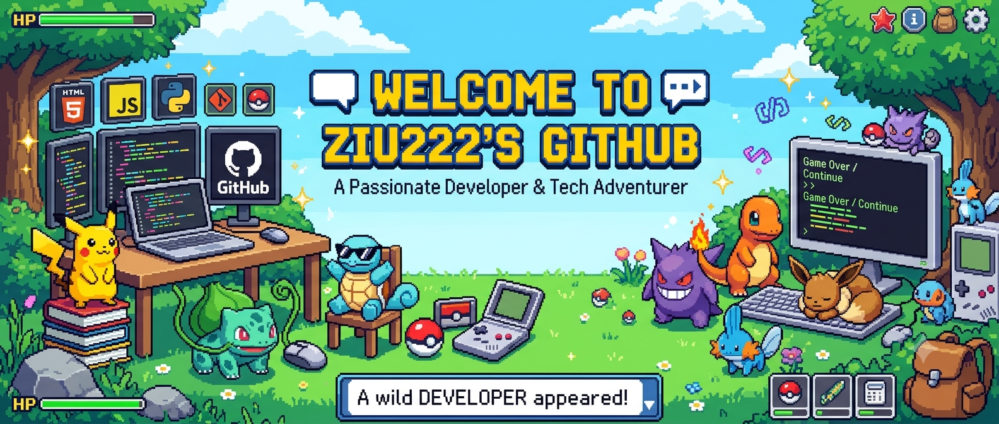
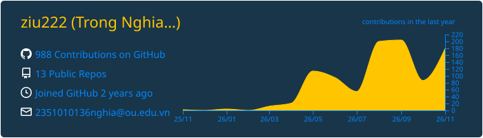
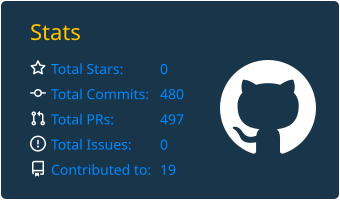
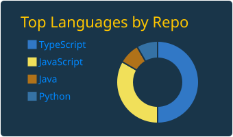
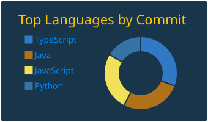
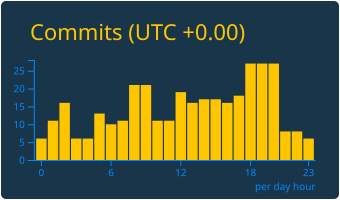

 

  

 

 &nbsp;
 &nbsp;
 &nbsp;
 &nbsp;
 &nbsp;
 &nbsp;

♥ my fav Pokémon: Wooper

##  Trainer card

  

##  Tech stack

<table>
  <tr>
    <td align="center" valign="top"> <b>Frontend</b> </td>
    <td align="center" valign="top"> <b>Backend languages</b> </td>
  </tr>
  <tr>
    <td align="center" valign="top"> <b>Backend frameworks</b> </td>
    <td align="center" valign="top"> <b>Databases</b> </td>
  </tr>
  <tr>
    <td align="center" valign="top"> <b>DevOps</b> </td>
    <td align="center" valign="top"> <b>Cloud</b> </td>
  </tr>
</table>

##  Featured projects

<table>
  <tr>
    <td width="50%" valign="top">
      
      <h3><a href="https://github.com/ziu222/Dishcover">Dishcover</a></h3>
      
AI smart fridge and recipe recommender. Eight Spring Boot microservices behind an API gateway, a Vietnamese RAG chatbot, Vision AI ingredient recognition and expiry alerts, deployed on AWS ECS.

      
   

      <a href="https://www.dishcover.online">Live demo</a> · <a href="https://github.com/ziu222/Dishcover">Source</a>
    </td>
    <td width="50%" valign="top">
      
      <h3><a href="https://github.com/ziu222/assistance-chatbot">Atlas</a></h3>
      
AI customer-support agents with a human in the loop. The agent climbs a trust ladder of Manual, Shadow, Learning and Autopilot, with shadow-mode evals, per-intent autopilot and cost-optimized LLM pipelines.

      
   

      <a href="https://github.com/ziu222/assistance-chatbot">Source</a>
    </td>
  </tr>
  <tr>
    <td width="50%" valign="top">
      
      <h3><a href="https://github.com/ziu222/eCommerce-website-project">E-commerce</a></h3>
      
Storefront and admin area for an online shop: browse, cart and auth for customers, plus dashboard, products, orders and finance for admins. Backed by NestJS, Prisma and PostgreSQL.

      
   

      <a href="https://github.com/ziu222/eCommerce-website-project">Source</a>
    </td>
    <td width="50%" valign="top">
      
      <h3><a href="https://github.com/ziu222/TypeTrace">TypeTrace</a></h3>
      
TypeScript MERN starter with email-OTP auth, roles, an admin area with data tables, a generator that scaffolds backend and frontend modules, and a Gemini chat bot. Forked from Hakidie/TypeTrace.

      
   

      <a href="https://type-trace-wheat.vercel.app">Live demo</a> · <a href="https://github.com/ziu222/TypeTrace">Source</a>
    </td>
  </tr>
</table>

   &nbsp;
  

##  GitHub activity

  

 &nbsp;
 &nbsp;
 &nbsp;

